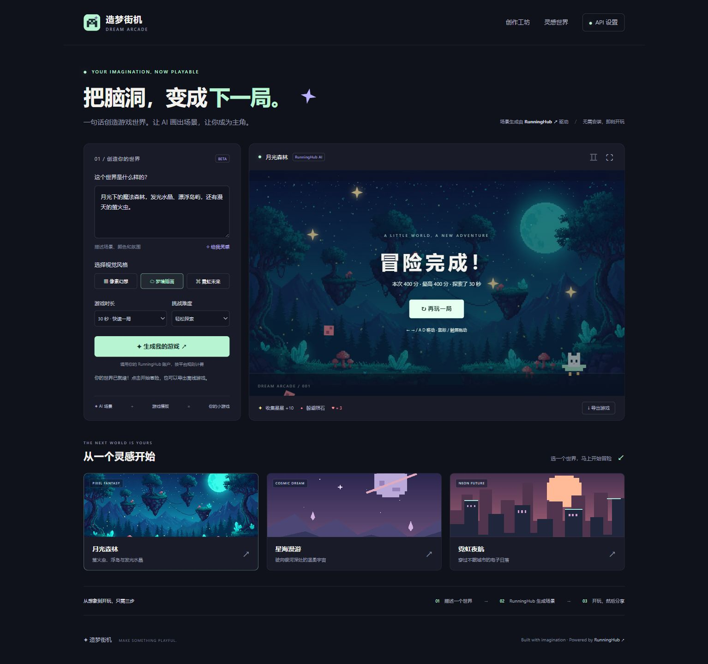

# ✦ 造梦街机 · Dream Arcade

**把脑洞，变成下一局。** 输入一句主题描述，通过 RunningHub 生成游戏场景，再立即进入可以游玩的迷你街机。

**[在线试玩 →](https://ritrls.github.io/dream-arcade-demo/)**



这是一个浏览器端演示项目：**AI 生成场景图片，固定游戏模板提供玩法**。不宣称自动生成任意游戏代码或游戏引擎。

随附的 `playable-demo.html` 已嵌入场景图片，可以直接双击离线试玩。

## 可以做什么

- 生成像素幻想、梦境插画、霓虹未来风格的场景。
- 驾驶小猫飞船，收集星星，躲避陨石；支持键盘、鼠标与触屏。
- 切换 30/45/60 秒游戏时长和两种难度，暂停与全屏游玩。
- 三个内置主题，无需 Key 也能试玩。
- 导出含场景图片的独立 HTML 文件，双击即可离线玩，也可直接分享文件。
- 查询真实 RunningHub 任务状态；停止等待、刷新后继续查询已有任务。

## 本地运行

需要 Node.js 22 或更新版本，无第三方依赖。

```sh
npm run dev
```

打开 http://127.0.0.1:4173 。不需要 npm install。

```sh
npm test
npm run build
```

构建结果在 `dist/`，可放在任意静态托管平台。源代码使用相对路径，支持 GitHub Pages 仓库子路径。

## RunningHub 接入

1. 在 [RunningHub](https://www.runninghub.cn/) 获取具有模型 API 权限的企业共享 Key。
2. 点击页面右上角「API 设置」并填写 Key。
3. 描述场景、选择风格，点击「生成我的游戏」。调用按照 RunningHub 账户规则计费。
4. 等待任务完成后点击「开始冒险」或「导出游戏」。

使用官方模型接口：

```text
POST https://www.runninghub.ai/openapi/v2/rhart-image-v1/text-to-image
Authorization: Bearer <visitor-provided-key>
Content-Type: application/json

{"prompt":"...","aspectRatio":"16:9"}

POST https://www.runninghub.ai/openapi/v2/query
{"taskId":"..."}
```

每 5 秒查询一次，最长等待 10 分钟。失败、取消、网络错误和超时都会显示提示；任务编号保存在当前标签页 sessionStorage 中，可使用同一个 Key 继续查询。停止等待不会取消 RunningHub 上的任务，也不会撤销可能产生的计费。提交请求不自动重试，以避免重复创建付费任务；查询可对临时故障进行有限重试。

Key **只存在当前页面内存中**，不会写入 localStorage、仓库、导出文件或服务端。刷新页面后需要重新填写。请求从浏览器直接发送至 RunningHub 官方国际站接口，依赖其跨域访问支持；本项目不使用第三方公共代理。浏览器联调发现 `.cn` 网关返回重复的跨域响应头，因此使用已验证的官方 `.ai` 网关。请勿把个人 Key 放进公开网页代码。

官方文档说明生成链接有时效，页面会尝试将结果转为内嵌图片；请及时导出。若平台图片跨域限制导致不能打包，页面会明确提示；可以使用预设世界导出。预设月光森林的真实生成图片已下载到仓库内，不依赖临时结果 URL。

模型与协议来源：[官方接口契约](https://github.com/HM-RunningHub/ComfyUI_RH_OpenAPI/blob/main/developer-kit/rh-api-contract.md)、[官方模型参数表](https://github.com/HM-RunningHub/ComfyUI_RH_OpenAPI/blob/main/developer-kit/model-registry.public.json)。模型权限及费用以 RunningHub 当前规则为准。

## GitHub Pages 部署

仓库包含 `.github/workflows/pages.yml`：推送到 `main` 会先运行接口契约测试，再构建并部署。

首次部署时在仓库 **Settings → Pages → Build and deployment → Source** 选择 **GitHub Actions**。不需要把 RunningHub Key 添加到 GitHub Secrets；每位访问者使用自己的 Key。

## 项目结构

```text
index.html / style.css   页面与响应式布局
app.js                  创作、设置、任务恢复和离线导出
engine.js               可独立运行的 Canvas 游戏模板
runninghub.js           RunningHub 提交与轮询
assets/                 内置场景、真实生成记录、品牌图标
tests/                  API 生命周期与错误处理测试
build.mjs               零依赖静态构建
```

## 致谢

受 [PixelRunner](https://github.com/XIAOTsune/PixelRunner) 将 RunningHub 能力接入具体创作工具的思路启发。本项目独立实现，没有复制其代码或品牌素材。

AI 场景能力由 **RunningHub API** 提供。本项目为独立技术演示，并非 RunningHub 官方产品。其名称与商标属于各自权利人。

## 许可证

代码与手绘 SVG 示例采用 MIT 许可证。AI 图片的使用同时遵循 RunningHub 和相应模型的服务条款。
